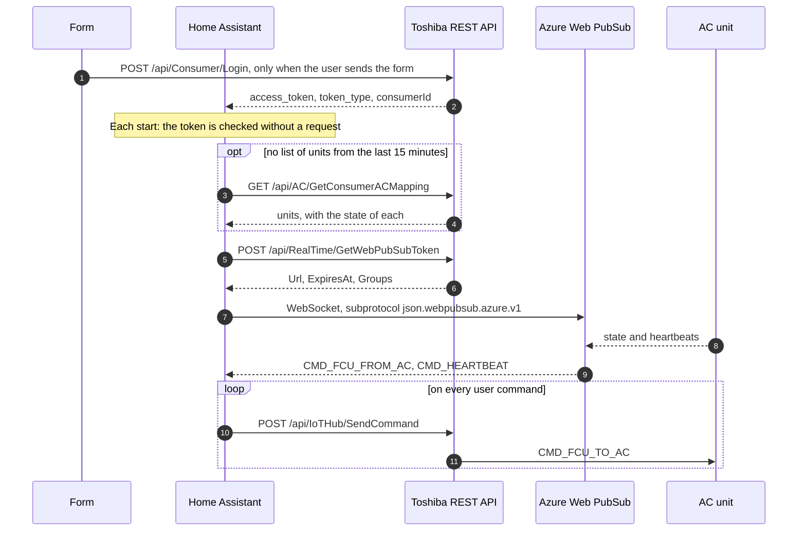

# Authentication and requests

How this integration authenticates against Toshiba's servers, and every request it
makes. The first goal of this design is that no restart, however often it happens, can
harm the account.

Toshiba's real limits are unknown. Its web application firewall (WAF) limits requests,
and failed logins count toward an account lockout. So nothing here can promise that an
account never gets blocked. It keeps the requests few, and stops at the first sign of
trouble.

## Credentials

| Credential | Obtained from | Sent to | Stored |
|------------|---------------|---------|--------|
| Username and password | The form | `POST /api/Consumer/Login` | Username only, in the entry |
| Access token, a JWT that lasts about two years | The login | Every HTTPS request | In the entry |
| Socket address, with its own token, good for one connection | `POST /api/RealTime/GetWebPubSubToken` | Azure Web PubSub | Nowhere |

**The password is not stored.** It has no use after the login, and what is not stored
cannot be retried. When a token stops working, Home Assistant asks for the password.

## Requests

| Endpoint | Method | When |
|----------|--------|------|
| `/api/Consumer/Login` | POST | When the user sends a form, and never otherwise |
| `/api/AC/GetConsumerACMapping` | GET | At a start without a recent list, about every 30 minutes, and after a reconnection, at most every 5 minutes |
| `/api/RealTime/GetWebPubSubToken` | POST | Each time the socket opens, since an address works for one connection |
| `/api/IoTHub/SendCommand` | POST | Once per command |
| `/api/AC/GetGroupACEnergyConsumption` | POST | At most hourly, only if a unit reports energy |

All requests carry a `Device-ID` header, from the device id in the entry, and an empty
`User-Agent`. None is ever retried automatically. A failure waits for the next turn.

The login, the list of units and the socket were confirmed on two real accounts, and
commands on one real unit of model 2. The command endpoint was found through
[`christoh/FroniusMonitor`](https://github.com/christoh/FroniusMonitor). Its answer has
`Status`, `FailedTargetIds` and `UnauthorizedTargetIds`, and the unit's echo carries the
`messageId` of the command.

## What protects the account

`toshiba/guard.py` keeps these on disk, and saves them before the request is sent. A
restart starts with what it knew, so restarting cannot reset them.

| Situation | Reaction |
|-----------|----------|
| More than 120 requests in an hour | No request until the hour ends |
| HTTP 403 or 429 | No request at all for 15 minutes, doubling up to a day, or longer if `Retry-After` says so. Setup waits with `retry_after`, and asks for no password |
| HTTP 401 | The token is never sent again, and Home Assistant asks for the password |
| A token that says it expired | The same, without a request |
| 3 failed logins in an hour on one account | The form says to try later, and sends nothing |
| A restart | Reuses a list of units up to 15 minutes old and an energy reading up to an hour old, so it costs one request for the socket address, or two after 15 minutes |

`tests/test_account_safety.py` proves these against a local server that counts requests.
Keep it passing, and extend it with any new request.

## Setup failures

| Failure | Reported as |
|---------|-------------|
| Login rejected, on the form | "Invalid username or password" |
| Limit reached or blocked, on the form | "Too many attempts" |
| Anything else, on the form | "Failed to connect" |
| Token rejected or expired | Reauthentication |
| Blocked, or over budget | Retry after the remaining wait |
| Network, timeout, other HTTP errors | Retry with the normal growing wait |
