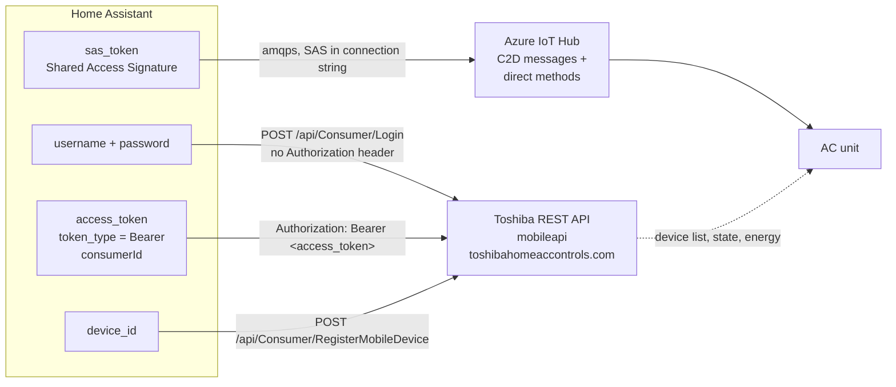
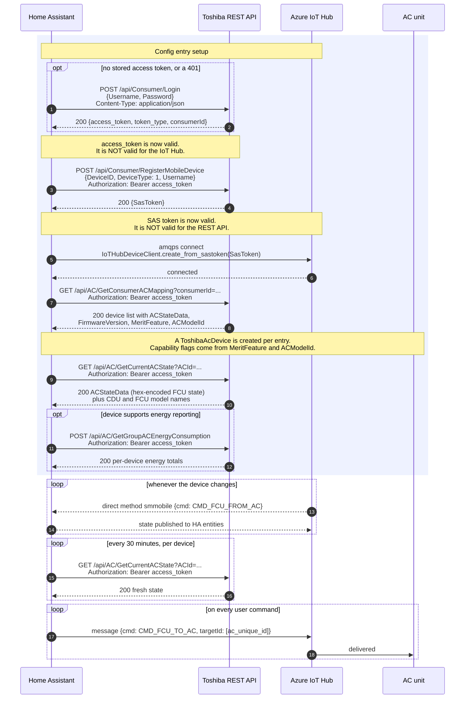

# Authentication

How this integration authenticates against Toshiba's servers, which credential
travels to which endpoint, and which feature uses which transport.

Two independent credentials are involved. They are obtained in sequence, from
two different services, and each is only valid for one of them.

## Credentials at a glance

| Credential | Type | Obtained from | Sent to | Protects |
|------------|------|---------------|---------|----------|
| Username + password | user input | — | `POST /api/Consumer/Login` (request body) | Nothing on its own |
| Access token | Opaque bearer token | `POST /api/Consumer/Login` | Every HTTPS call to `mobileapi.toshibahomeaccontrols.com` | REST API reads |
| SAS token | Shared Access Signature | `POST /api/Consumer/RegisterMobileDevice` | Azure IoT Hub (AMQP) | Live device link, all commands |

The access token and the SAS token are **not** interchangeable. The access token
never leaves the HTTPS host, and the SAS token is only ever used by the Azure
IoT Hub client.

Note that commands never travel over HTTPS. Every write to the device goes out
through the IoT Hub link.

## Bootstrap sequence

These requests are part of config entry setup. That matters for error handling,
see [below](#setup-failures). The login only happens when no access token is
stored, or when Toshiba rejects the stored one with a 401.

The connection steps are bounded by a 30-second timeout, so a hanging IoT Hub
connection cannot block Home Assistant startup.

## Endpoints

| Endpoint | Method | Bearer token | Purpose | Called |
|----------|--------|--------------|---------|--------|
| `/api/Consumer/Login` | POST | no | Exchange credentials for access token, get `consumerId` | When adding the entry, then only when the stored token is rejected |
| `/api/Consumer/RegisterMobileDevice` | POST | yes | Register this Home Assistant instance, obtain SAS token | On every setup and on SAS renewal |
| `/api/AC/GetConsumerACMapping` | GET | yes | List AC units and their capabilities | Once per setup |
| `/api/AC/GetCurrentACState` | GET | yes | Full device state, plus CDU/FCU model names | Once per setup, then every 30 min |
| `/api/AC/GetGroupACEnergyConsumption` | POST | yes | Energy totals per device | Every 60 min, only if supported |

All HTTPS requests carry a `Device-ID` header, which Toshiba's web application
firewall uses to tell installations apart. The library sets it, from the device id
in the entry.

## Transport per feature

This is the part that matters when diagnosing behaviour: **every control is
written over AMQP, only reads use HTTPS.**

| Entity | Platform | Read from | Written to |
|--------|----------|-----------|-------------|
| HVAC mode, power | `climate` | AMQP push | AMQP `set_ac_status` / `set_ac_mode` |
| Target temperature | `climate` | AMQP push | AMQP `set_ac_temperature` |
| Fan speed | `climate` (via `set_fan_mode`) | AMQP push | AMQP `set_ac_fan_mode` |
| Swing | `climate` (via `set_swing_mode`) | AMQP push | AMQP `set_ac_swing_mode` |
| CDU silent, fireplace | `select` | AMQP push | AMQP via entity description (`ac_merit_a` / `ac_merit_b`) |
| 8 degree heating, air purifier, eco mode, high power | `switch` | AMQP push | AMQP via entity description (`ac_merit_a` / `ac_merit_b` / `ac_air_pure_ion`) |
| Horizontal swing, on units with independent axes | `climate` | AMQP push | AMQP `set_ac_horizontal_swing_mode` |
| Wireless LED | `switch` | AMQP push | AMQP `set_ac_wireless_led` |
| Indoor and outdoor temperature, self cleaning | `sensor`, `binary_sensor` | AMQP push | — |
| Energy consumption | `sensor` | REST every 60 min | — |

Read the two columns together. Every entity reads its current value from an AMQP
push, and only the energy consumption sensor is refreshed over HTTPS. No setting
is ever written over HTTPS — all writes go out as AMQP messages.

Outbound commands are published as AMQP messages with the payload
`{"cmd": "CMD_FCU_TO_AC", "targetId": [<ac_unique_id>], ...}`. The device state
itself travels as a hex-encoded string inside that payload.

Inbound, Toshiba calls a direct method named `smmobile` on the IoT Hub link.
Two commands are handled:

| Inbound command | Meaning |
|-----------------|---------|
| `CMD_FCU_FROM_AC` | New device state |
| `CMD_HEARTBEAT` | Keep-alive |

Any other command name is ignored with an info-level log line.

## Token lifetime

The SAS token carries its own expiry. Before it runs out, the Azure client signals
`on_new_sastoken_required`, which makes the library call `RegisterMobileDevice`
again and hand the new token back. No user interaction and no restart is involved.

The SAS token is not stored. It may have expired while Home Assistant was stopped,
so every setup registers a new one.

The access token, its type and the consumer id are stored in the config entry and
passed to the library at setup, so a restart, a reload or the
`toshiba_ac_link.reconnect` action skips `/api/Consumer/Login`, the most
rate-limited endpoint. When Toshiba answers a stale token with a 401, the library
logs in again once and the integration stores the new token.

## Setup failures

Where a request fails decides how the failure is reported.

**Adding the entry or reauthenticating.** The form shows the error. Failed logins
are never retried by the library, because Toshiba counts them toward an account
lockout.

**Config entry setup.** Connecting and fetching the device list when Home Assistant
starts or reloads the integration, each within 30 seconds. Only
`ToshibaAcHttpApiAuthError` asks for the password. Searching the text of an error
for `auth` or `403` is what made WAF responses look like a wrong password.

| Failing step | Reported as |
|--------------|-------------|
| Login rejected, on the form | Form error "Invalid username or password" |
| Anything else, on the form | Form error "Failed to connect" |
| Login rejected, during setup | Reauthentication flow |
| IoT Hub refuses the connection | Retry with backoff, plus a persistent notification about the single connection |
| Rate limit, WAF, network, timeout, device list | Retry with backoff |

A refusal on a SAS token that was issued seconds ago is not a credential problem,
and the integration says so instead of implying a wrong password. See
[`codebase-architecture.md`](codebase-architecture.md#one-connection-per-account).
