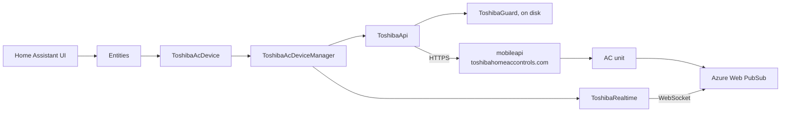

# Architecture

How the Toshiba Link integration talks to Toshiba.

## Entity platforms

| Platform | Entities |
|----------|----------|
| `climate` | Thermostat: HVAC mode, temperature, fan mode, swing, power preset |
| `binary_sensor` | Self cleaning |
| `select` | Outdoor unit silent mode, fireplace mode |
| `sensor` | Indoor temperature, outdoor temperature, energy consumption |
| `switch` | 8 °C mode, air purifier, ECO mode, high power mode, wireless LED |

Entities are created per device and only for features the model actually
supports. A device without energy monitoring gets no energy sensor.

## Transports

| Transport | Purpose | Direction |
|-----------|---------|-----------|
| HTTPS | Login, list of units, socket address, commands, energy | Request and response |
| Azure Web PubSub, over one WebSocket | What the units publish | Push |

The list of units gives the full state at the start, and every 30 minutes as a safety
net. Commands and pushes also correct the saved list, so a restart shows them at once. A start
that reused a saved list asks again after 5 minutes, because the socket misses what
changes while it is closed. The socket brings changes in between.

## Units that join or leave

Each list of units is compared with what is loaded. A unit that is new and can be read
reloads the entry. A unit that two lists in a row leave out loses its device, entities and
what the user set on them, so an empty list or one with an unreadable unit decides nothing.
The registry also tells about a unit that left while Home Assistant was stopped.

## Realtime messages

Each frame is a Web PubSub message from the group of one unit, with this in `data`:

| Field | Meaning |
|-------|---------|
| `sourceId` | The `DeviceUniqueId` of the unit |
| `cmd` | `CMD_FCU_FROM_AC` for a state, `CMD_HEARTBEAT` for temperatures |
| `messageId` | A counter of the unit, or `MB_...` when it repeats a client's command |
| `payload` | `{"data": "<hex state>"}`, or one hex byte per heartbeat value |

A state is either full, or partial with `ff` in the fields that did not change, so it is
always merged. Measured on two accounts:

- A socket stayed open and kept receiving after its 15-minute token expired. The token
  only opens the connection. Longer than 20 minutes is untested, and the client simply
  reconnects if the server closes.
- A socket address works for one connection. A second one gets HTTP 401, even before the
  address expires, so addresses are never reused.
- Heartbeats are irregular: 6 in 20 minutes across 5 units. They say nothing about
  availability, so a ping checks the socket instead.
- A command from this client was echoed within a second, and reached another client in
  about a second. Changes made in the app arrived 90 to 100 seconds after the time in
  their own messages, four times. The cause of the difference is unknown. A command updates the state as soon as Toshiba accepts
  it, and a slow answer from the unit must never lead to a repeat.
- In the 8 °C mode the wire value is the target plus 16. A model 3 unit held it at 32, or
  16 °C, when sent more, so its limit is 16 although the app's code suggests 30. Model 2
  accepted 10 and 13 °C, and more was not tried. Entering and leaving this mode does not
  change the wire value by itself, so 13 °C would become 29 °C. So `send_state_to_ac` sends
  a target with both: 8 °C, and then the earlier target or 20 °C.
- Of about 30 accepted commands, two on one unit in a row got no echo, and the unit did not
  apply them, although Toshiba answered `Success`. The same sequence worked when repeated.
  The entity shows a command at once, so without an echo after 2 minutes a warning is
  logged and the list corrects the state. The command is never repeated.
- A unit reports its swing byte by itself when it turns on and off, with messages that do
  not carry the `MB_` id of a client.
- The app and another client can be connected to one account at the same time.
- The timestamps of a unit's own messages are about an hour ahead, and off by tens of
  seconds per unit. Do not use them.

## Component files

| File | Role |
|------|------|
| `__init__.py` | Config entry setup, error classification, the reconnect action |
| `config_flow.py` | The forms, the only place that logs in |
| `const.py` | Domain |
| `climate.py` | Climate entity |
| `binary_sensor.py` | Binary sensor entities |
| `sensor.py` | Sensor entities |
| `select.py` | Select entities |
| `switch.py` | Switch entities |
| `entity.py` | Shared base entity |
| `entity_description.py` | Shared helpers of the enum descriptions |
| `feature_list.py` | Enum name helpers |
| `diagnostics.py` | Troubleshooting download |
| `toshiba/guard.py` | Limits and reusable answers, on disk |
| `toshiba/api.py` | One HTTPS request per call |
| `toshiba/realtime.py` | The socket, with its reconnection |
| `toshiba/manager.py` | The account: units, channel, periodic requests |
| `toshiba/device.py` | One unit, the interface that entities use |
| `toshiba/fcu_state.py`, `features.py`, `properties.py` | Decoding of the state and the features, from `toshiba-ac-community` under Apache-2.0 (see `toshiba/NOTICE`) |

See [`authentication.md`](authentication.md) for the requests and for what protects the
account.

## Entity availability

An entity is available while the socket is open. Commands use HTTPS and do not depend on
it, but without the socket the state could be out of date. It also depends on the unit:

* **Model capabilities.** Whether fireplace mode, 8 °C heating and similar functions
  exist at all depends on the unit, so entities for what it lacks are not created.
* **Mode.** Some switches and selects are unavailable when they do not apply, such as
  while the unit is off.

## Error handling

| Condition | Result |
|-----------|--------|
| Network error, timeout, server error | Setup retry with a growing wait |
| Blocked by Toshiba, or over the request budget | Setup retry after the remaining wait |
| Token rejected or expired | Reauthentication, see [`authentication.md`](authentication.md#setup-failures) |
| Socket lost | Entities unavailable, reconnection by itself with growing waits |

## Reporting problems

Include the diagnostics download from the integration page. It contains the
device state and the request counters, with the account and credentials redacted.
